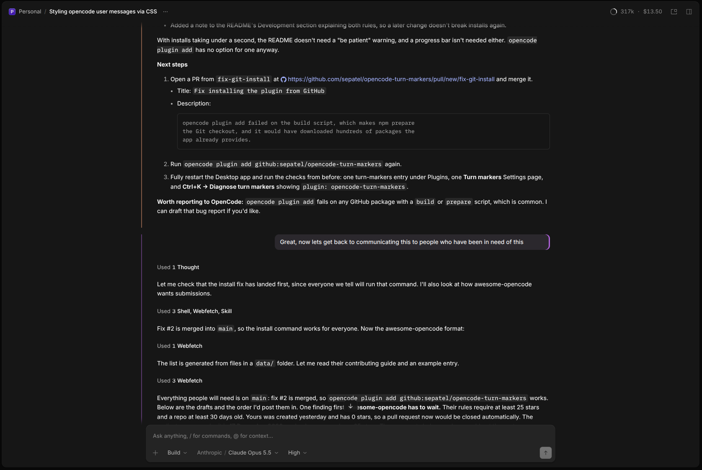
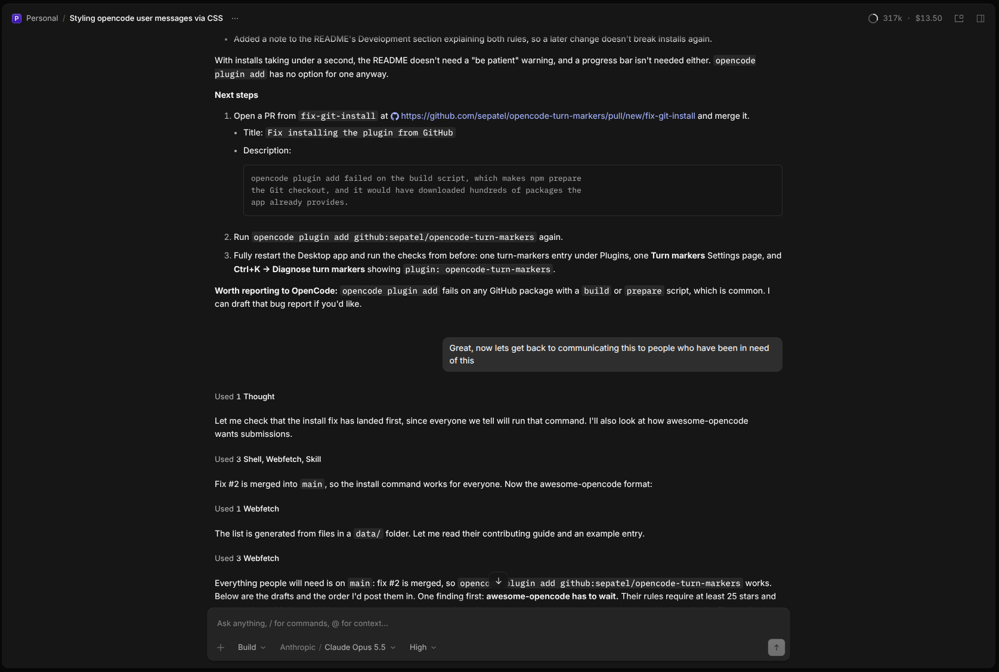
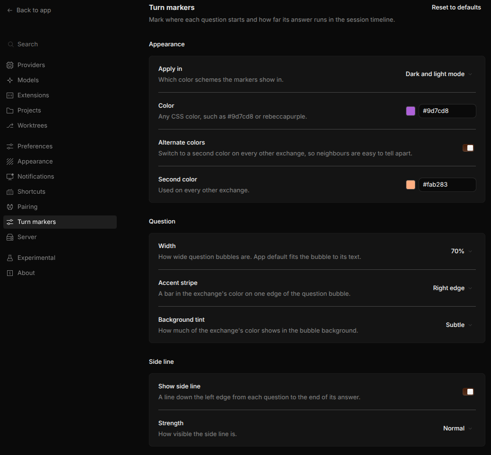

# Turn markers for OpenCode Desktop

In a long session it's hard to see where one question's answer ends and the next question begins. This plugin marks
each exchange in the OpenCode Desktop timeline:

- **Question bubbles** get a faint tint and a coloured stripe on one edge, at a width you choose.
- **A side line** runs down the left from each question to the end of its answer.
- **Colours alternate** between exchanges, so neighbouring exchanges are easy to tell apart.

Everything is adjustable in **Settings → Turn markers**.



<details>
<summary>The same session without the plugin</summary>



</details>

## Install

```sh
opencode plugin add github:sepatel/opencode-turn-markers
```

Then fully quit OpenCode Desktop and reopen it. The plugin shows up under **Settings → Extensions → Plugins**, and its
settings page under **Settings → Turn markers**.

## Update

OpenCode checks for new versions but doesn't install them on its own. To get the latest:

```sh
opencode plugin update github:sepatel/opencode-turn-markers
```

Then fully quit and reopen the Desktop app.

## Settings



| Setting | Default | What it does |
| --- | --- | --- |
| Apply in | Dark and light mode | Dark mode, light mode, or both |
| Color | `#9d7cd8` | Any CSS colour |
| Alternate colors | On | Use a second colour on every other exchange |
| Second color | `#fab283` | The colour for every other exchange |
| Width | 70% | Question bubble width, from the app default (fit to text) to full width |
| Accent stripe | Right edge | Right edge, left edge, or none |
| Background tint | Subtle | How much of the exchange colour shows in the bubble |
| Question text | App default | Text colour of your sent messages |
| Pending text | App default | Text colour of messages queued while the agent is still working |
| Show side line | On | The line from each question to the end of its answer |
| Strength | Normal | How visible the side line is |

**Reset to defaults** at the top of the page puts everything back.

The default colours come from [opencode-cli-theme](https://github.com/Mehdi-afs/opencode-cli-theme), which brings the
OpenCode CLI's palette to the Desktop app, so the two look right together. The screenshots above use the app's default
theme.

## Troubleshooting

- **The markers disappear after an OpenCode update.** Fully quit and reopen the app once. If they're still missing, the
  app may have changed the internal names this plugin styles; please
  [open an issue](https://github.com/sepatel/opencode-turn-markers/issues) with your app version.
- **Colours don't alternate.** Open the command palette (**Ctrl+K**, or **Cmd+K** on macOS), run **Diagnose turn
  markers**, and include its output in an issue.
- **To turn it off,** use the switch in **Settings → Extensions → Plugins**, or run
  `opencode plugin remove opencode-turn-markers`.

## Compatibility

Tested with OpenCode Desktop 2.3.0 on Linux. It uses the Desktop's GUI plugin API, which OpenCode marks as
experimental, and styles the timeline's internal markup, which can change between releases.

It doesn't apply to the web interface opened with `opencode pair`, which doesn't load Desktop plugins.

## Development

```sh
git clone https://github.com/sepatel/opencode-turn-markers.git
cd opencode-turn-markers
bun install
bun run dev        # rebuilds dist/ on every change
```

Point OpenCode at your checkout in `~/.config/opencode/opencode.jsonc`, then restart the Desktop app once. After that,
each rebuild reloads the plugin in every window.

```jsonc
{
  "plugins": ["/path/to/opencode-turn-markers"],
}
```

`dist/gui-experimental.cjs` is committed, because installing from GitHub doesn't run a build. Run `bun run bundle` and
commit the result with every change. `bun run typecheck` checks the types.

Keep the package free of runtime dependencies, and don't add `build`, `prepare`, `prepack` or `install` scripts. Any of
those makes npm prepare the Git checkout on install, which `opencode plugin add` can't do.

## License

[MIT](LICENSE)
